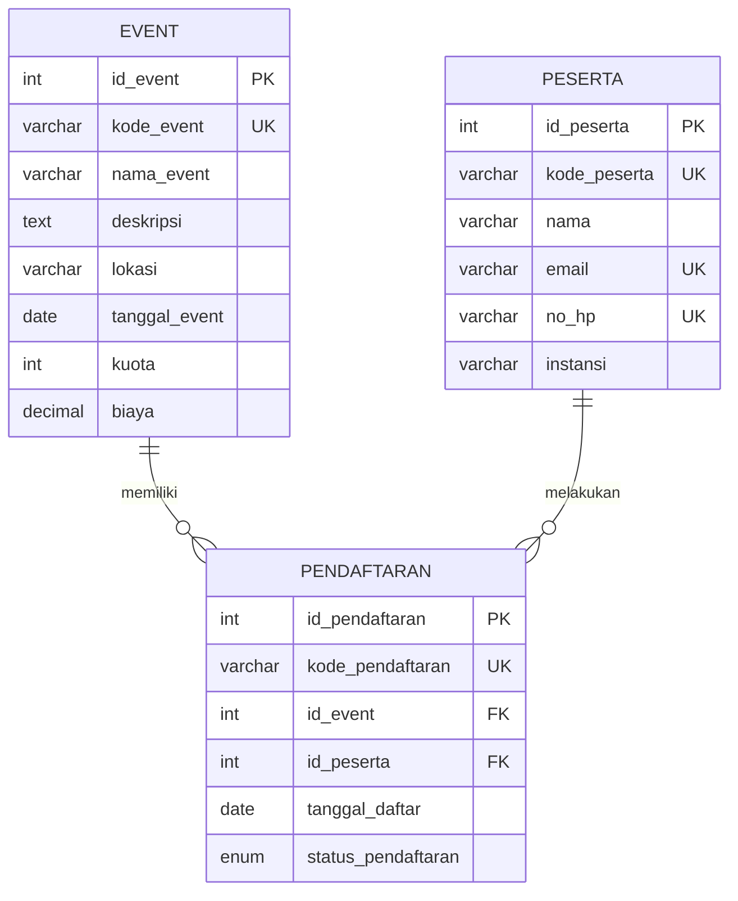

# UTS - Sistem Manajemen Event

REST API PHP Native + MySQLi + JSON untuk pengelolaan event, peserta, dan pendaftaran.

## 1. Anggota kelompok

Isi NIM dan nama anggota sebelum pengumpulan.

| No. | NIM | Nama | Tugas |
|---|---|---|---|
| 1 | Isi NIM | Isi nama | Tema, ERD, database, schema.sql, seed data |
| 2 | Isi NIM | Isi nama | Config, helper, GET, JOIN, search, pagination |
| 3 | Isi NIM | Isi nama | POST, validasi, status 201/400/409 |
| 4 | Isi NIM | Isi nama | PUT, DELETE, keamanan, testing |

## 2. Teknologi
- PHP 8.1+ disarankan
- MySQL / MariaDB
- Laragon atau XAMPP
- VS Code + Thunder Client
- Git + GitHub

## 3. ERD



Relasi:
- `event.id_event` 1:N `pendaftaran.id_event`
- `peserta.id_peserta` 1:N `pendaftaran.id_peserta`
- Satu peserta hanya boleh terdaftar satu kali pada event yang sama (`UNIQUE(id_event,id_peserta)`).

## 4. Struktur folder

```text
uts-event/
├── api/
│   ├── event.php
│   ├── peserta.php
│   └── pendaftaran.php
├── helpers/
│   └── response.php
├── config.php
├── database/
│   └── schema.sql
├── thunderclient/
│   └── UTS.Thunderclient_collection.json
├── screenshot/
│   └── README.txt
├── README.md
├── link-video.txt
└── .gitignore
```

## 5. Cara menjalankan
1. Jalankan Apache dan MySQL dari Laragon/XAMPP.
2. Letakkan folder `uts-event` di `C:/laragon/www/` atau `C:/xampp/htdocs/`.
3. Buka phpMyAdmin, lalu import `database/schema.sql`. Import ulang akan DROP dan membuat ulang tabel project beserta data seed.
4. Sesuaikan koneksi di `config.php` bila username/password MySQL berbeda.
5. Tes endpoint, misalnya `http://localhost/uts-event/api/event.php`.
6. Untuk Android Emulator, gunakan `http://10.0.2.2/uts-event/api/`.

## 6. Daftar endpoint

Base URL: `http://localhost/uts-event`

| Endpoint | Method | URL | Fungsi |
|---|---|---|---|
| event.php | GET | `/api/event.php` | Semua event |
| event.php | GET | `/api/event.php?id=1` | Detail event |
| event.php | GET | `/api/event.php?search=seminar&page=1&limit=10` | Search + pagination |
| event.php | POST | `/api/event.php` | Tambah event |
| event.php | PUT | `/api/event.php?id=1` | Ubah event |
| event.php | DELETE | `/api/event.php?id=1` | Hapus event |
| peserta.php | GET | `/api/peserta.php` | Semua peserta |
| peserta.php | GET | `/api/peserta.php?id=1` | Detail peserta |
| peserta.php | GET | `/api/peserta.php?search=andi&page=1&limit=10` | Search + pagination |
| peserta.php | POST | `/api/peserta.php` | Tambah peserta |
| peserta.php | PUT | `/api/peserta.php?id=1` | Ubah peserta |
| peserta.php | DELETE | `/api/peserta.php?id=1` | Hapus peserta |
| pendaftaran.php | GET | `/api/pendaftaran.php` | Semua pendaftaran + JOIN |
| pendaftaran.php | GET | `/api/pendaftaran.php?id=1` | Detail pendaftaran + JOIN |
| pendaftaran.php | GET | `/api/pendaftaran.php?search=andi&page=1&limit=10` | Search + pagination |
| pendaftaran.php | POST | `/api/pendaftaran.php` | Tambah pendaftaran |
| pendaftaran.php | PUT | `/api/pendaftaran.php?id=1` | Ubah pendaftaran |
| pendaftaran.php | DELETE | `/api/pendaftaran.php?id=1` | Hapus pendaftaran |

GET pendaftaran menggunakan JOIN untuk menampilkan `nama_event` dan `nama_peserta`, bukan hanya ID relasi.

## 7. Contoh body JSON

### POST event
```json
{
  "kode_event": "EVT-006",
  "nama_event": "Seminar Data Science",
  "deskripsi": "Pengenalan analisis data untuk pemula.",
  "lokasi": "Aula Kampus",
  "tanggal_event": "2026-12-15",
  "kuota": 100,
  "biaya": 30000
}
```

### POST peserta
```json
{
  "kode_peserta": "PST-006",
  "nama": "Fajar Ramadhan",
  "email": "fajar@example.com",
  "no_hp": "081234560006",
  "instansi": "Institut Atma Luhur"
}
```

### POST pendaftaran
```json
{
  "kode_pendaftaran": "REG-2026-006",
  "id_event": 1,
  "id_peserta": 3,
  "tanggal_daftar": "2026-10-30",
  "status_pendaftaran": "terdaftar"
}
```

Status pendaftaran: `terdaftar`, `hadir`, `batal`.

## 8. Kontrak response

Semua response konsisten:

```json
{
  "status": true,
  "message": "Pesan response",
  "data": {}
}
```

Status HTTP:
- 200: GET, PUT, DELETE berhasil.
- 201: POST berhasil.
- 400: body, field, atau parameter tidak valid.
- 404: data atau relasi tidak ditemukan.
- 409: data unik duplikat atau peserta sudah terdaftar pada event yang sama.
- 405: method tidak diizinkan.
- 500: kesalahan server dengan pesan generik.

Untuk GET daftar, `data` memiliki `items` dan `pagination`. GET dengan `id` menghasilkan satu object.

## 9. Keamanan
- Query database menggunakan `mysqli_prepare()` dan parameter binding.
- Parameter angka divalidasi dan dikonversi ke integer.
- Search menggunakan prepared statement; wildcard `%` ditempel di PHP.
- Error SQL dicatat dengan `error_log`, detail SQL tidak dikirim ke client.
- Foreign Key dan UNIQUE menjaga integritas data.
- Uji `?id=1' OR 1=1 --`; parameter ID tidak valid harus ditolak dan tidak boleh membocorkan data.

CORS contoh ini menggunakan `*` untuk latihan lokal. Batasi origin jika aplikasi dipublikasikan.

## 10. Pengujian
Import `thunderclient/UTS.Thunderclient_collection.json` melalui Thunder Client. Atur environment `baseUrl` menjadi `http://localhost/uts-event`. Jalankan request sukses dan gagal, lalu simpan screenshot hasil nyata ke folder `screenshot/`.

Collection berisi contoh GET, POST, PUT, DELETE, serta kasus 400, 404, 405, dan 409. Pastikan data uji tidak bentrok ketika request POST dijalankan berulang kali; ubah kode unik untuk pengujian ulang.

## 11. GitHub
```bash
git init
git add .
git commit -m "Initial project event management API"
git branch -M main
git remote add origin https://github.com/USERNAME/uts-event.git
git push -u origin main
```
Buat commit terpisah sesuai kontribusi anggota.

## 12. Video presentasi
Semua anggota harus tampil dengan wajah dan suara jelas, menjelaskan bagian yang dikerjakan dan alasan teknisnya, serta mendemonstrasikan project. Upload video ke Google Drive dan masukkan link ke `link-video.txt`.

## 13. Kontrak untuk UAS
Setelah UTS, pertahankan nama file endpoint, nama field, dan struktur JSON. Aplikasi Kotlin + Retrofit akan bergantung pada kontrak API ini.
