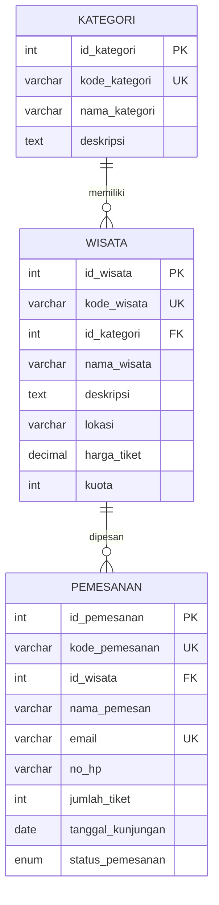

# UTS - Sistem Manajemen Wisata

REST API PHP Native + MySQLi + JSON untuk pengelolaan tempat wisata, kategori wisata, dan pemesanan tiket.

## 1. Anggota kelompok

| No. | NIM | Nama | Tugas |
|---|---|---|---|
| 1 | 2511500085 | Irsya | Config, helper, GET, JOIN, search, pagination | 
| 2 | 2511500047 | Pika | POST, validasi, status 201/400/409 |
| 3 | 2511500083 | Salsa | PUT, DELETE, keamanan, testing |
| 4 | 2511500086 | Dedi | Tema, ERD, database, schema.sql, seed data |

## 2. Teknologi
- PHP 8.1+ disarankan
- MySQL / MariaDB
- Laragon atau XAMPP
- VS Code + Thunder Client
- Git + GitHub

## 3. ERD



Relasi:
- `kategori.id_kategori` 1:N `wisata.id_kategori`
- `wisata.id_wisata` 1:N `pemesanan.id_wisata`

## 4. Struktur folder

```text
uts-wisata/
├── api/
│   ├── kategori.php
│   ├── wisata.php
│   └── pemesanan.php
├── helpers/
│   └── response.php
├── config.php
├── database/
│   └── schema.sql
├── thunderclient/
│   └── UTS.Thunderclient_collection.json
├── screenshot/
│   └── README.txt
├── README.md
├── link-video.txt
└── .gitignore
```

## 5. Cara menjalankan
1. Jalankan Apache dan MySQL dari Laragon/XAMPP.
2. Letakkan folder `uts-wisata` di `C:/laragon/www/` atau `C:/xampp/htdocs/`.
3. Buka phpMyAdmin, lalu import `database/schema.sql` ke database **`db_wisata`**. Import ulang akan DROP dan membuat ulang tabel project beserta data seed.
4. Sesuaikan koneksi di `config.php` (DB Name: `db_wisata`) bila username/password MySQL berbeda.
5. Tes endpoint, misalnya `http://localhost/uts-wisata/api/wisata.php`.
6. Untuk Android Emulator, gunakan `http://10.0.2.2/uts-wisata/api/`.

## 6. Daftar endpoint

Base URL: `http://localhost/uts-wisata`

| Endpoint | Method | URL | Fungsi |
|---|---|---|---|
| kategori.php | GET | `/api/kategori.php` | Semua kategori |
| kategori.php | GET | `/api/kategori.php?id=1` | Detail kategori |
| kategori.php | GET | `/api/kategori.php?search=pantai&page=1&limit=10` | Search + pagination |
| kategori.php | POST | `/api/kategori.php` | Tambah kategori |
| kategori.php | PUT | `/api/kategori.php?id=1` | Ubah kategori |
| kategori.php | DELETE | `/api/kategori.php?id=1` | Hapus kategori |
| wisata.php | GET | `/api/wisata.php` | Semua wisata + JOIN Kategori |
| wisata.php | GET | `/api/wisata.php?id=1` | Detail wisata + JOIN Kategori |
| wisata.php | GET | `/api/wisata.php?search=parangtritis&page=1&limit=10` | Search + pagination |
| wisata.php | POST | `/api/wisata.php` | Tambah wisata |
| wisata.php | PUT | `/api/wisata.php?id=1` | Ubah wisata |
| wisata.php | DELETE | `/api/wisata.php?id=1` | Hapus wisata |
| pemesanan.php | GET | `/api/pemesanan.php` | Semua pemesanan + JOIN Wisata |
| pemesanan.php | GET | `/api/pemesanan.php?id=1` | Detail pemesanan + JOIN Wisata |
| pemesanan.php | GET | `/api/pemesanan.php?search=andi&page=1&limit=10` | Search + pagination |
| pemesanan.php | POST | `/api/pemesanan.php` | Tambah pemesanan |
| pemesanan.php | PUT | `/api/pemesanan.php?id=1` | Ubah pemesanan |
| pemesanan.php | DELETE | `/api/pemesanan.php?id=1` | Hapus pemesanan |

GET wisata menggunakan JOIN ke `kategori` (`nama_kategori`), dan GET pemesanan menggunakan JOIN ke `wisata` (`nama_wisata`).

## 7. Contoh body JSON

### POST kategori
```json
{
  "kode_kategori": "KAT-001",
  "nama_kategori": "Wisata Alam",
  "deskripsi": "Destinasi wisata berbasis keindahan alam dan pegunungan."
}
```

### POST wisata
```json
{
  "kode_wisata": "WST-006",
  "id_kategori": 1,
  "nama_wisata": "Pantai Parai Tenggiri",
  "deskripsi": "Pantai indah dengan bebatuan granit eksotis.",
  "lokasi": "Sungailiat, Bangka",
  "harga_tiket": 25000,
  "kuota": 200
}
```

### POST pemesanan
```json
{
  "kode_pemesanan": "BOOK-2026-001",
  "id_wisata": 1,
  "nama_pemesan": "Fajar Ramadhan",
  "email": "fajar@example.com",
  "no_hp": "081234560006",
  "jumlah_tiket": 2,
  "tanggal_kunjungan": "2026-12-25",
  "status_pemesanan": "pending"
}
```

Status pemesanan: `pending`, `lunas`, `batal`.

## 8. Kontrak response

Semua response konsisten:

```json
{
  "status": true,
  "message": "Pesan response",
  "data": {}
}
```

Status HTTP:
- 200: GET, PUT, DELETE berhasil.
- 201: POST berhasil.
- 400: body, field, atau parameter tidak valid.
- 404: data atau relasi tidak ditemukan.
- 409: data unik duplikat (misal kode unik sudah digunakan).
- 405: method tidak diizinkan.
- 500: kesalahan server dengan pesan generik.

Untuk GET daftar, `data` memiliki `items` dan `pagination`. GET dengan `id` menghasilkan satu object.

## 9. Keamanan
- Query database menggunakan `mysqli_prepare()` dan parameter binding.
- Parameter angka divalidasi dan dikonversi ke integer.
- Search menggunakan prepared statement; wildcard `%` ditempel di PHP.
- Error SQL dicatat dengan `error_log`, detail SQL tidak dikirim ke client.
- Foreign Key dan UNIQUE menjaga integritas data.
- Uji `?id=1' OR 1=1 --`; parameter ID tidak valid harus ditolak dan tidak boleh membocorkan data.

CORS contoh ini menggunakan `*` untuk latihan lokal. Batasi origin jika aplikasi dipublikasikan.

## 10. Pengujian
Import `thunderclient/UTS.Thunderclient_collection.json` melalui Thunder Client. Atur environment `baseUrl` menjadi `http://localhost/uts-wisata`. Jalankan request sukses dan gagal, lalu simpan screenshot hasil nyata ke folder `screenshot/`.

Collection berisi contoh GET, POST, PUT, DELETE, serta kasus 400, 404, 405, dan 409. Pastikan data uji tidak bentrok ketika request POST dijalankan berulang kali; ubah kode unik untuk pengujian ulang.

## 11. GitHub
```bash
git init
git add .
git commit -m "Initial project tourism management API"
git branch -M main
git remote add origin https://github.com/USERNAME/uts-wisata.git
git push -u origin main
```
Buat commit terpisah sesuai kontribusi anggota.

## 12. Video presentasi
Semua anggota harus tampil dengan wajah dan suara jelas, menjelaskan bagian yang dikerjakan dan alasan teknisnya, serta mendemonstrasikan project. Upload video ke Google Drive dan masukkan link ke `link-video.txt`.

## 13. Kontrak untuk UAS
Setelah UTS, pertahankan nama file endpoint, nama field, dan struktur JSON. Aplikasi Kotlin + Retrofit akan bergantung pada kontrak API ini.